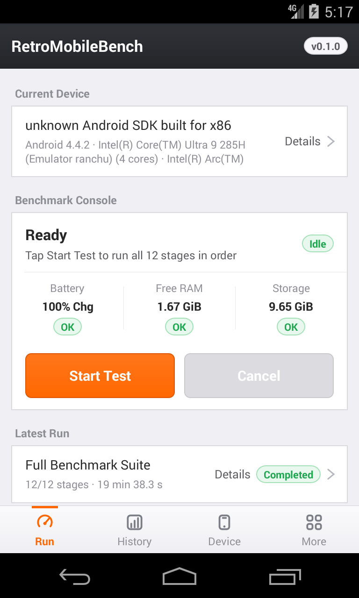
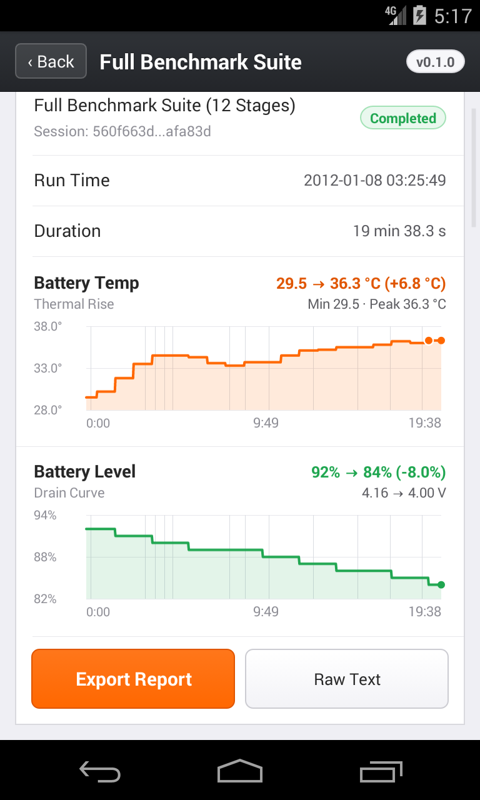
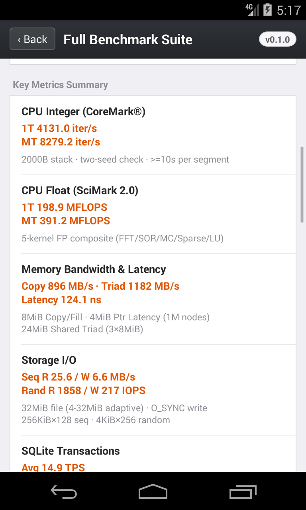
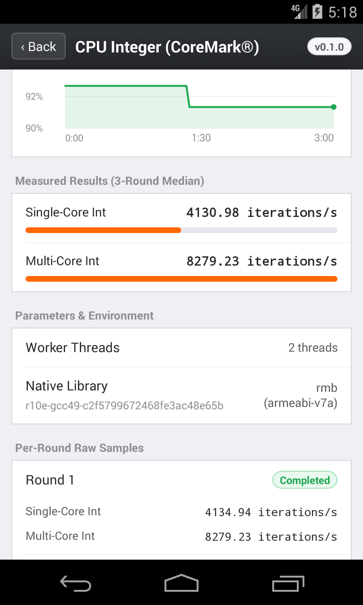
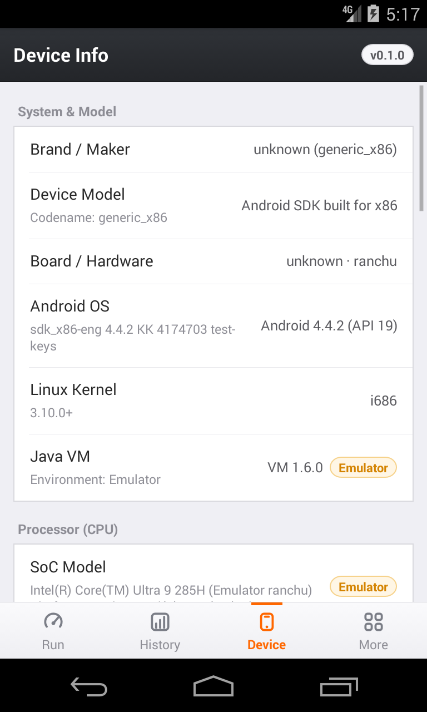
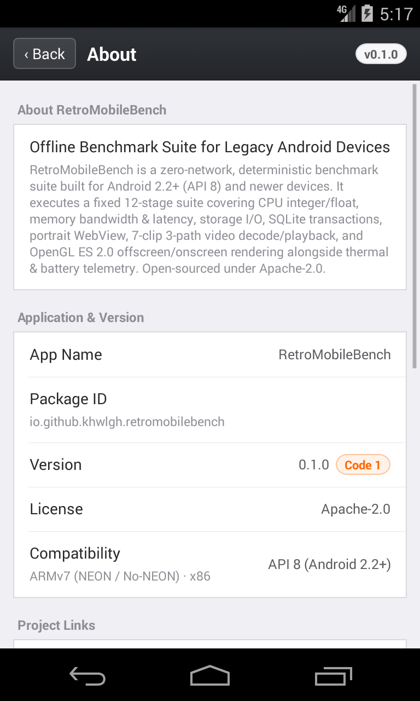

<div align="center">


# RetroMobileBench

[简体中文](README.md) | **English** | [Changelog](CHANGELOG.md)

Offline Benchmark Suite for Legacy Android Phones & Tablets (Version `0.1.0` · Protocol `fixed-suite-v1`)

[](https://github.com/KHWLGH/RetroMobileBench/releases)
[](https://github.com/KHWLGH/RetroMobileBench/releases)
[](LICENSE)
[-3DDC84.svg?logo=android&logoColor=white)](docs/en/development.md)
[%20%7C%20x86-555555.svg)](docs/en/development.md)
[](https://github.com/KHWLGH/RetroMobileBench/stargazers)
[](https://github.com/KHWLGH/RetroMobileBench/commits)
[](https://github.com/KHWLGH/RetroMobileBench/issues)

</div>

---

**RetroMobileBench** (`io.github.khwlgh.retromobilebench`) is a zero-network, offline benchmark suite built with pure native Java Framework `View` primitives and C/C++ native kernels. Styled in a lightweight **MIUI V5-inspired UI**, it targets **ARMv7 devices from Android 2.2 (API 8)**—shipping both runtime-selected NEON and non-NEON (`VFPv3-D16`) native libraries—as well as **x86 devices from Android 2.3 (API 9)**.

With one tap on **Start Test**, the app executes **12 deterministic stages** covering CPU integer/float, memory bandwidth & latency, internal storage I/O, SQLite transactions, portrait WebView feed & HD image decoding, 7-clip 3-path video decode/playback, and OpenGL ES 2.0 offscreen/onscreen rendering, recording thermal and battery curves throughout with full Chinese/English localization.

## Why RetroMobileBench?

When revisiting vintage Android phones and tablets, most classic benchmarks—especially **GPU benchmarks** that relied on external asset packs—no longer work out of the box today:

- **No official asset download channel for GLBenchmark / GFXBench**: Store releases of GLBenchmark and GFXBench shipped as small APKs (~20–50 MB) that downloaded hundreds of megabytes of scene assets from Kishonti's servers on first launch. After Kishonti shut down GFXBench / CompuBench services in late November 2025, delisted the apps, and took the asset servers offline, legacy **GLBenchmark 2.5 / 2.7** and **GFXBench 3.x–5.x** APKs fail during server checks or data downloads. While Kishonti open-sourced the code and assets on GitHub, no prebuilt APKs are provided, and the default build targets Android 5.0+ (`minSdk 21`) at over 1 GB—unusable on Android 2.2–4.4 devices.
- **Broken DLC downloads in legacy 3DMark (Ice Storm, etc.)**: 3DMark downloads test modules (DLC) online per device without offline transfer support. After UL migrated endpoints to HTTPS (TLS 1.2+), Android 4.x devices with outdated CA roots or no default TLS 1.2 fail to fetch DLCs, while current 3DMark releases require Android 6.0+ and ended support for Ice Storm in 2020.
- **Missing OBB expansion packs in Basemark X / Basemark OS II / Epic Citadel**: These Unity and Unreal Engine 3 benchmarks were discontinued and delisted years ago. They relied on Google Play's APK + OBB expansion delivery, so standalone APKs found on mirrors fail with Play resource lookup errors when the matching `.obb` data is missing.
- **Disappearance of early classics**: **NenaMark 1/2/3**, **Qualcomm Neocore**, **Quadrant**, and **Qualcomm Vellamo** have all been removed from official stores, with archived APKs often breaking due to dead endpoints or legacy runtime incompatibilities.

To solve this, **RetroMobileBench** bundles every native kernel, shader, ETC1 texture subset (porting Egypt HD / T-Rex / Fill from open-source GFXBench), media clip, and Web workload directly inside a single APK—zero internet access, zero external data packs, install and run from Android 2.2 onward.

## Screenshots

> Captured on a GPU-accelerated Android 4.4 emulator (`768×1280`) with full 12-stage benchmark measurements imported from a real **Samsung GT-I9260** (TI OMAP 4470 · Android 4.1.2). Simplified Chinese screenshots are available in [docs/screenshots/zh/](docs/screenshots/zh/).

<table>
  <tr>
    <td align="center" width="33%">
      <br />
      <sub><b>Run Console</b> (Device Summary &amp; Preflight)</sub>
    </td>
    <td align="center" width="33%">
      <br />
      <sub><b>GT-I9260 Report</b> (Thermal &amp; Battery Curves)</sub>
    </td>
    <td align="center" width="33%">
      <br />
      <sub><b>Key Metrics Summary</b> (One-Tap Copy)</sub>
    </td>
  </tr>
  <tr>
    <td align="center" width="33%">
      <br />
      <sub><b>Stage Detail</b> (Workloads &amp; Raw Rounds)</sub>
    </td>
    <td align="center" width="33%">
      <br />
      <sub><b>Device Tab</b> (SoC, Kernel &amp; VM Probe)</sub>
    </td>
    <td align="center" width="33%">
      <br />
      <sub><b>About</b> (<code>v0.1.0</code> · Apache-2.0 · Project Links)</sub>
    </td>
  </tr>
</table>

## Key Features

- **12-Stage Offline Fixed Suite (`fixed-suite-v1`)**: Every shader, texture pack, video clip, and Web workload is bundled inside the APK with zero internet access required. The first 6 stages run 3 median rounds while Video and the 5 GPU stages run once each.
- **Bilingual UI & Locale-Aware Reports (Chinese / English / Follow System)**: Switch anytime under **More → Language / 界面语言**. **UI screens, in-app reports, key metrics summaries, and exported `.csv` / `.txt` files follow the selected language**, while JSON keys and `fixed-suite-v1` protocol tags remain invariant.
- **Explicit Workloads Without Synthetic Total Scores**: Instead of an opaque composite score, RetroMobileBench reports actual per-stage measurements and explicitly annotates workloads across Memory (8 MiB Copy/Fill, 4 MiB Pointer Chase, 24 MiB Shared Triad), Storage (4–32 MiB adaptive, `O_SYNC` / `O_DIRECT`), and SQLite (900 individual `COMMIT`s, `FULL` sync), with one-tap summary copying.
- **Scenario-Driven Fullscreen & Live GPU HUD**: Main console and portrait Web tasks lock to portrait fullscreen; onscreen GPU and video playback launch dedicated landscape fullscreen windows, with a live top-left HUD showing window swap FPS and battery temperature (~1 s updates).
- **Dual-Series Telemetry & Checkpoint Recovery**: Polls battery temperature, percentage, voltage, and stage name every 2 seconds in the background to plot thermal & battery curves. Each completed round is checkpointed to SQLite; cancelling, backgrounding, screen lock, or Surface loss safely aborts and preserves completed samples.
- **Lossless Cross-API File Export & Sharing**: Exports complete sessions (all stages, raw rounds, SoC/topology snapshot, and telemetry time series) to `.json` (`retromobilebench-full-v1`), Excel-ready `.csv` (UTF-8 BOM), or `.txt` via public `Download/RetroMobileBench/`, system Share, or Android 4.4+ SAF.
- **Zero External Runtime Dependencies**: No AndroidX, Jetpack Compose, Kotlin stdlib, or Google Play Services—compiled into a single legacy DEX (`035`) for broad compatibility on vintage Android ROMs.

## 12-Stage Fixed Suite Summary

> Combined configured rendering time across the 5 GPU stages is 6 min 38 s (excluding asset verification and extraction).

| # | Stage | Workload & Methodology | Rounds | Primary Metrics |
|---|---|---|---|---|
| 1 | **CPU Integer (CoreMark®)** | Single-core + N threads; 2000 B stack, dual-seed CRC validation, >=10 s/segment | 3 | `iterations/s` (1T / MT) |
| 2 | **CPU Float (SciMark 2.0)** | Single-core + N threads; FFT / SOR / Monte Carlo / Sparse / LU kernels | 3 | Composite `MFLOPS` + per-kernel |
| 3 | **Memory Bandwidth & Latency** | 8 MiB Copy/Fill + 4 MiB Pointer Chase (1M nodes) + 24 MiB Shared Triad | 3 | `MB/s`, `ns` |
| 4 | **Storage I/O** | 32 MiB private file (4–32 MiB adaptive) · 256 KiB Seq ×128 · 4 KiB Rand ×256 | 3 | Seq `MB/s`, Rand `IOPS` |
| 5 | **SQLite Transactions** | SQLite 3.53.1 · 300 tx each for INSERT / UPDATE / DELETE (1 KiB/row, `FULL`) | 3 | Composite Avg `TPS` + breakdown |
| 6 | **Web Feed & Large Images** | `:web` portrait WebView · 640 cards + 2000 list items + 480 text blocks + 20× HD decodes | 3 | `total_ms`, `feed_ms`, `image_ms` |
| 7 | **Video Decode & Playback** | 7 clips 240p–1080p (H.263 / MPEG-4 / H.264 / VP8 / VP9) × 3 paths | 1 | SW / System / Playback `FPS` |
| 8 | **GPU Egypt HD (Offscreen)** | OpenGL ES 2.0 · ETC1 textures · 1920×1080 FBO · 113 s | 1 | `FPS`, `frames` |
| 9 | **GPU Egypt HD (Onscreen)** | OpenGL ES 2.0 · ETC1 textures · Native window resolution · 113 s | 1 | `FPS`, `frames` |
| 10 | **GPU T-Rex (Offscreen)** | OpenGL ES 2.0 · ETC1 textures · 1920×1080 FBO · 56 s | 1 | `FPS`, `frames` |
| 11 | **GPU T-Rex (Onscreen)** | OpenGL ES 2.0 · ETC1 textures · Native window resolution · 56 s | 1 | `FPS`, `frames` |
| 12 | **GPU Texture Fill Rate** | OpenGL ES 2.0 · ETC1 textures · 1920×1080 FBO quad-layer blend · 60 s | 1 | `MTexels/s` |

## Quick Build

Follow [Development & Build](docs/en/development.md) first to initialize Git submodules, sparse GFXBench assets, and the NDK r10e toolchain (all native production code compiles with GCC 4.9 in `.tools/android-ndk-r10e`).

Once ready, run from the project root:

```powershell
$env:JAVA_HOME = 'C:/Program Files/Android/Android Studio/jbr'
.\gradlew.bat :app:prepareLegacyNdk --console=plain
.\gradlew.bat :app:assembleDebug :app:assembleDebugAndroidTest :app:lintDebug --console=plain
```

To package the matching LGPL corresponding source archive for APK distribution:

```powershell
.\gradlew.bat :app:correspondingSource --console=plain
```

`targetSdk` is intentionally set to `23` (installable on Android 14+ while preserving legacy behavior), JAR/v1 signing remains enabled for Froyo, and Lint `NewApi` / `InlinedApi` checks are fatal errors.

## Documentation

| English | 简体中文 | Contents |
|---|---|---|
| [Benchmarks & Results](docs/en/benchmarks.md) | [测试与结果](docs/zh/benchmarks.md) | 12-stage workloads, explicit measurements, Web feed & image decode specs, timing & export formats |
| [Development & Build](docs/en/development.md) | [开发与构建](docs/zh/development.md) | Architecture, bilingual i18n, lifecycle, legacy ABI compatibility, 7 dependencies & build workflow |
| [Validation & Limits](docs/en/validation.md) | [验证与限制](docs/zh/validation.md) | Static ELF/NEON checks, `am instrument` entry points & historical device compatibility fixes |
| [Licenses & Distribution](docs/en/licenses.md) | [许可与分发](docs/zh/licenses.md) | Apache-2.0 license, third-party component table, CC BY attributions & FFmpeg LGPL source delivery |
| [Changelog](CHANGELOG.md) | [更新日志](CHANGELOG.md) | Release history and notable changes |

## License

RetroMobileBench's original source code and original documentation are licensed under the [Apache License 2.0](LICENSE). Bundled third-party benchmark components (CoreMark, SciMark 2.0, tinymembench, STREAM, SQLite, GFXBench, FFmpeg) and CC BY 3.0 / CC BY 4.0 media/scene assets remain under their respective licenses and attribution terms; see [Licenses & Distribution](docs/en/licenses.md).
