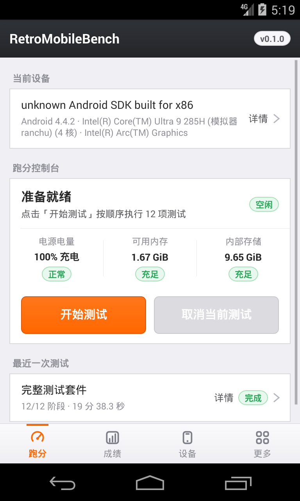
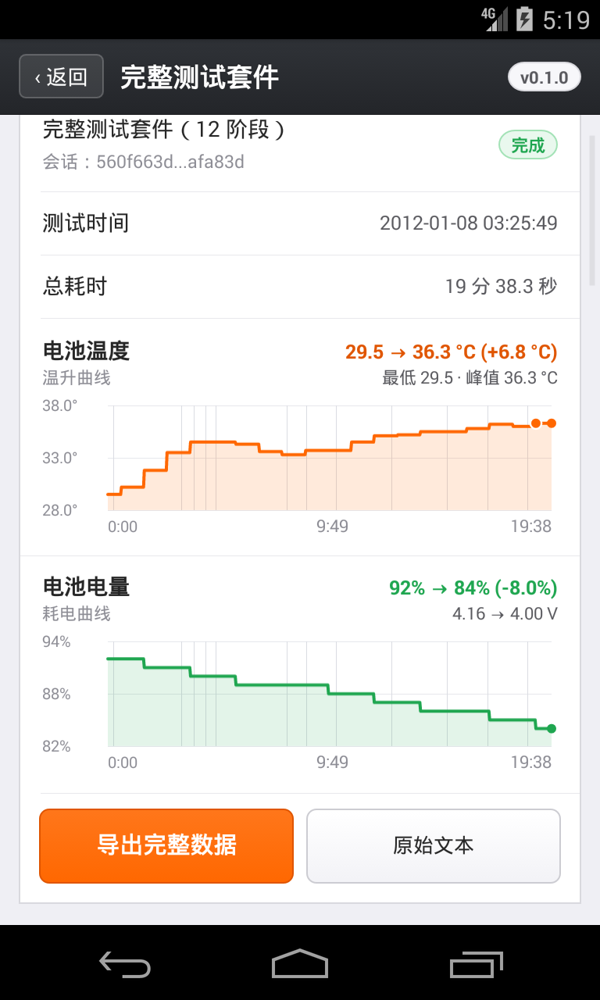
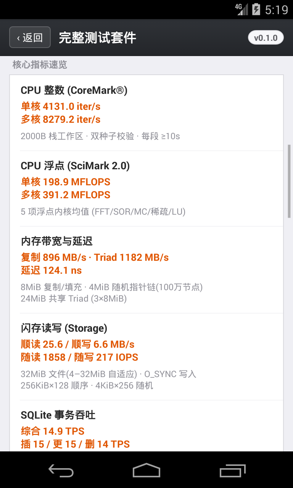
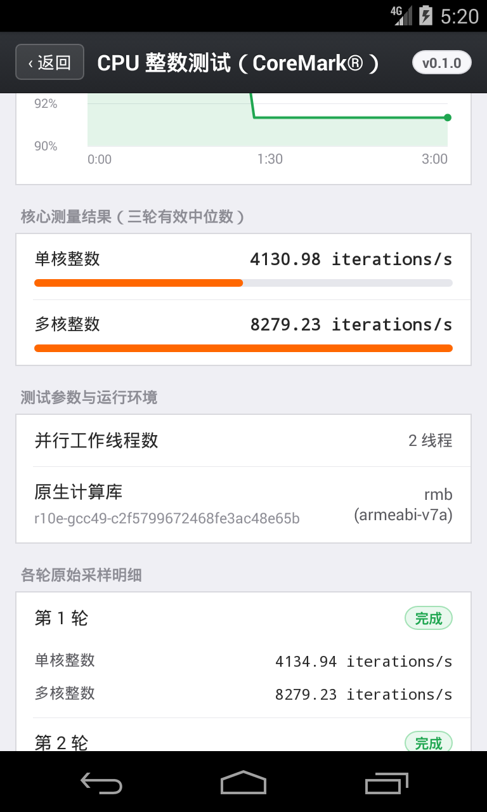
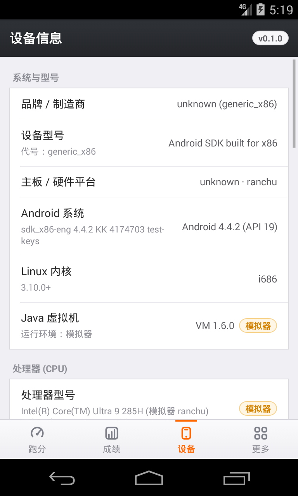
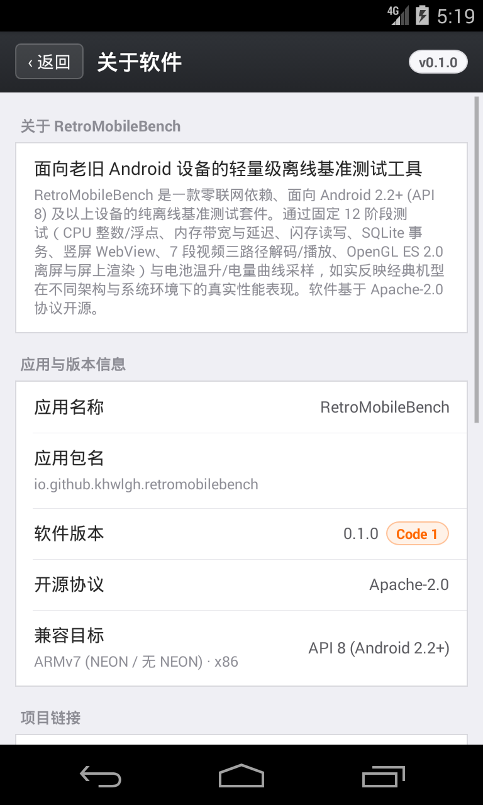

<div align="center">


# RetroMobileBench

**简体中文** | [English](README.en.md) | [更新日志](CHANGELOG.md)

面向旧款 Android 手机和平板的纯离线基准测试套件（版本 `0.1.0` · 测试协议 `fixed-suite-v1`）

[](https://github.com/KHWLGH/RetroMobileBench/releases)
[](https://github.com/KHWLGH/RetroMobileBench/releases)
[](LICENSE)
[-3DDC84.svg?logo=android&logoColor=white)](docs/zh/development.md)
[%20%7C%20x86-555555.svg)](docs/zh/development.md)
[](https://github.com/KHWLGH/RetroMobileBench/stargazers)
[](https://github.com/KHWLGH/RetroMobileBench/commits)
[](https://github.com/KHWLGH/RetroMobileBench/issues)

</div>

---

**RetroMobileBench**（包名 `io.github.khwlgh.retromobilebench`）是一款零联网依赖、基于纯原生 Java Framework `View` 与 C/C++ 原生内核构建的离线基准测试工具。应用采用 **MIUI V5 风格轻量级界面**，兼容从 **Android 2.2（API 8）起的 ARMv7 设备**（内置运行时探测并分别提供 NEON 与 VFPv3-D16 无 NEON 双原生库）以及 **Android 2.3（API 9）起的 x86 设备**。

点击「开始测试」后，应用按固定顺序串行执行 **12 个测试阶段**，覆盖 CPU 整数/浮点算力、内存带宽与延迟、闪存 I/O、SQLite 事务、Web 竖屏信息流与大图解码、7 段视频三路径解码/播放以及 OpenGL ES 2.0 离屏与屏上渲染，全程采样电池温升与电量曲线，并支持双语界面切换与完整数据导出。

## 为什么做这个项目

折腾旧款 Android 手机和平板时，当年常用的基准测试软件——尤其是依赖独立数据包运行的 **GPU 跑分软件**——如今大多已经无法正常使用：

- **GLBenchmark / GFXBench 已无官方数据下载渠道**：早期商店版 APK（仅约 20–50 MB）需要在首次启动时从 Kishonti 服务器在线拉取数百 MB 的场景纹理数据包。随着 Kishonti 于 2025 年 11 月底停止 GFXBench / CompuBench 服务、下架应用商店并关闭资源服务器，无论是早已下架的 **GLBenchmark 2.5 / 2.7**，还是 **GFXBench 3.x–5.x** 的历史安装包，如今都会卡在服务器校验或数据包下载失败。官方虽在 GitHub 开源了源码与场景资产，但未提供预编译 APK，且默认构建要求 Android 5.0+（`minSdk 21`）、完整打包体积超过 1 GB，无法直接跑在 Android 2.2–4.4 老设备上。
- **老版本 3DMark（Ice Storm 等）无法拉取 DLC**：3DMark 采用壳 APK + 在线按需下载测试模块（DLC）机制，且不支持离线迁移测试包；随着后台切换至 HTTPS（TLS 1.2+），缺乏现代根证书或默认未启用 TLS 1.2 的 Android 4.x 设备已无法完成下载，而新版客户端要求 Android 6.0+ 并已于 2020 年停止支持 Ice Storm。
- **Basemark X / Basemark OS II / Epic Citadel 缺失 OBB 扩展包**：这些基于 Unity 或 Unreal Engine 3 的经典图形测试早已停更下架，当年依赖 Google Play 的 APK + OBB 扩展分发机制。在第三方站往往只能找到几十 MB 的基础 APK，缺少对应 `.obb` 资源时启动即触发 Play 资源校验失败。
- **其他经典工具陆续退场**：**NenaMark 1/2/3**、**Qualcomm Neocore**、**Quadrant**、**Qualcomm Vellamo** 等早期测试软件也已全面退出官方应用商店，留存安装包常因在线接口失效或早期图形环境兼容问题无法运行。

为了不再受制于下架、停服和找不齐数据包的困扰，于是做了 **RetroMobileBench**：将所有测试内核、着色器、ETC1 纹理子集（基于开源 GFXBench 移植 Egypt HD / T-Rex / Fill 场景）、音视频语料与 Web 负载全部内置在单个 APK 中，无需任何网络连接或额外数据包下载，在 Android 2.2+ 老设备上安装即可开跑。

## 界面预览

> 以下主要界面截图采集自启用硬件加速的 Android 4.4 模拟器（`768×1280`），测试报告与阶段详情数据导入自三星 **GT-I9260**（TI OMAP 4470 · Android 4.1.2）完整 12 阶段实测记录；英文版主界面截图见 [docs/screenshots/en/](docs/screenshots/en/)。

<table>
  <tr>
    <td align="center" width="33%">
      <br />
      <sub><b>跑分控制台</b>（设备概览与状态预检）</sub>
    </td>
    <td align="center" width="33%">
      <br />
      <sub><b>GT-I9260 报告总览</b>（温升与电量双曲线）</sub>
    </td>
    <td align="center" width="33%">
      <br />
      <sub><b>核心指标速览</b>（一键复制关键指标）</sub>
    </td>
  </tr>
  <tr>
    <td align="center" width="33%">
      <br />
      <sub><b>阶段详情</b>（工作量标注与轮次样本）</sub>
    </td>
    <td align="center" width="33%">
      <br />
      <sub><b>设备信息</b>（SoC、内核与运行环境探测）</sub>
    </td>
    <td align="center" width="33%">
      <br />
      <sub><b>关于软件</b>（<code>v0.1.0</code> · Apache-2.0 · 项目链接）</sub>
    </td>
  </tr>
</table>

## 核心特性

- **12 阶段离线固定套件（`fixed-suite-v1`）**：全部测试素材、着色器、视频语料与 Web 测试页均随包离线分发，无需网络连接即可运行。常规 6 个阶段各测 3 轮取有效中位数，视频与 5 项 GPU 场景各运行 1 次。
- **双语界面与测试报告切换（中文 / English / 跟随系统）**：在「更多 → 界面语言 / Language」中可随时切换中文与英文；**应用界面、测试报告详情、核心指标速览以及导出的 `.csv` / `.txt` 报告均跟随当前语言动态输出**（同时保持 JSON 结构键名与 `fixed-suite-v1` 协议标识符跨语言一致）。
- **明确标注测试工作量与实测分布**：不合成虚幻“跑分总分”，而是在 UI 与导出报告中清晰呈现内存（8 MiB 复制/填充、4 MiB 随机指针链、24 MiB 共享 Triad）、存储（4–32 MiB 自适应、`O_SYNC` / `O_DIRECT`）与 SQLite（900 次独立 `COMMIT`、`FULL` 同步）的实际测试量及原始分项指标，支持一键复制核心指标速览。
- **场景化全屏与实时 GPU HUD**：主界面与 Web 竖屏信息流阶段固定为竖屏全屏；GPU 屏上测试与视频播放自动切换至独立横向全屏窗口，GPU 屏上阶段在左上角实时悬浮显示提交帧率与电池温度（约每秒更新一次）。
- **双曲线遥测与中断检查点保护**：后台每 2 秒采样一次电池温度、剩余电量、电压与当前阶段，生成温升与电量变化双曲线图。每完成一轮测试即写入数据库检查点；取消、切后台、锁屏或窗口丢失时安全停机并保留已完成样本。
- **跨版本无损导出与分享**：支持将包含全部分项、轮次原始样本、SoC/核心拓扑快照及温升/电量时间序列的数据导出为 `.json`（`retromobilebench-full-v1`）、Excel 兼容的 `.csv`（UTF-8 BOM）或 `.txt`，适配公共 `Download/RetroMobileBench/` 目录、系统分享及 Android 4.4+ SAF 另存为。
- **零外部运行时依赖**：生产代码不使用 AndroidX、Jetpack Compose、Kotlin 标准库或 Google Play 服务，打包为单 DEX（DEX `035`）以保持对最早期 Android 系统的兼容性。

## 12 阶段固定测试套件概览

> 5 项 GPU 场景配置总渲染时长为 6 分 38 秒（不含资源校验与解包耗时）。

| # | 测试阶段 | 测试方法与负载工作量 | 轮数 | 主要输出指标 |
|---|---|---|---|---|
| 1 | **CPU 整数（CoreMark®）** | 单核 + N 线程；2000 B 栈工作区，双种子 CRC 校验，每段 ≥10 s | 3 | `iterations/s`（单核 / 多核） |
| 2 | **CPU 浮点（SciMark 2.0）** | 单核 + N 线程；FFT / SOR / Monte Carlo / Sparse / LU 五内核 | 3 | 综合 `MFLOPS` 及各内核明细 |
| 3 | **内存带宽与延迟** | 8 MiB 复制/填充 + 4 MiB 随机指针链（100 万节点）+ 24 MiB 共享 Triad | 3 | `MB/s`、`ns` |
| 4 | **存储读写测试** | 32 MiB 私有文件（4–32 MiB 自适应）· 256 KiB 顺序 ×128 · 4 KiB 随机 ×256 | 3 | 顺序 `MB/s`、随机 `IOPS` |
| 5 | **SQLite 事务测试** | SQLite 3.53.1 · INSERT / UPDATE / DELETE 各 300 独立事务（1 KiB/行，`FULL`） | 3 | 综合平均 `TPS` 及分项 `TPS` |
| 6 | **Web 竖屏信息流与大图** | `:web` 独立竖屏 WebView · 640 卡片 + 2000 列表 + 480 长文 + 20 次高清大图解码 | 3 | `total_ms`、`feed_ms`、`image_ms` |
| 7 | **视频解码与播放** | 7 段 240p–1080p 素材（H.263 / MPEG-4 / H.264 / VP8 / VP9）× 3 条路径 | 1 | 软解 / 系统解码 / 实时播放 `FPS` |
| 8 | **GPU Egypt HD 离屏** | OpenGL ES 2.0 · ETC1 纹理 · 1920×1080 FBO · 113 s | 1 | `FPS`、`frames` |
| 9 | **GPU Egypt HD 屏上** | OpenGL ES 2.0 · ETC1 纹理 · 实际屏幕分辨率 · 113 s | 1 | `FPS`、`frames` |
| 10 | **GPU T-Rex 离屏** | OpenGL ES 2.0 · ETC1 纹理 · 1920×1080 FBO · 56 s | 1 | `FPS`、`frames` |
| 11 | **GPU T-Rex 屏上** | OpenGL ES 2.0 · ETC1 纹理 · 实际屏幕分辨率 · 56 s | 1 | `FPS`、`frames` |
| 12 | **GPU 纹理填充率** | OpenGL ES 2.0 · ETC1 纹理 · 1920×1080 FBO 四层多纹理混合 · 60 s | 1 | `MTexels/s` |

## 快速构建

请先按[开发与构建](docs/zh/development.md)初始化子模块、GFXBench 稀疏纹理数据与 NDK r10e 工具链（原生代码统一采用 `.tools/android-ndk-r10e` 中的 GCC 4.9 编译）。

环境就绪后，在项目根目录执行：

```powershell
$env:JAVA_HOME = 'C:/Program Files/Android/Android Studio/jbr'
.\gradlew.bat :app:prepareLegacyNdk --console=plain
.\gradlew.bat :app:assembleDebug :app:assembleDebugAndroidTest :app:lintDebug --console=plain
```

如需生成与分发 APK 完全匹配的 LGPL 对应源码归档：

```powershell
.\gradlew.bat :app:correspondingSource --console=plain
```

项目将 `targetSdk` 设为 `23`（满足 Android 14+ 安装要求且保持旧系统行为），保留 Froyo 所需的 JAR/v1 签名，并将 Lint `NewApi` / `InlinedApi` 设为编译错误。

## 文档导航

| 文档（中文） | English Docs | 内容说明 |
|---|---|---|
| [测试与结果](docs/zh/benchmarks.md) | [Benchmarks & Results](docs/en/benchmarks.md) | 12 阶段负载配置、明确测试量、Web 信息流与大图方案、计时校验及报告导出结构 |
| [开发与构建](docs/zh/development.md) | [Development & Build](docs/en/development.md) | 应用架构、双语本地化、生命周期、旧平台兼容、7 项第三方依赖与工具链构建流程 |
| [验证与限制](docs/zh/validation.md) | [Validation & Limits](docs/en/validation.md) | 静态 ELF/NEON 检查、设备 `am instrument` 测试入口及历史真机兼容修复记录 |
| [许可与分发](docs/zh/licenses.md) | [Licenses & Distribution](docs/en/licenses.md) | Apache-2.0 许可、第三方组件许可表、CC BY 素材署名及 FFmpeg LGPL 源码交付 |
| [更新日志](CHANGELOG.md) | [Changelog](CHANGELOG.md) | 版本发布记录与变更明细 |

## 许可协议

RetroMobileBench 原创代码与原创文档基于 [Apache License 2.0](LICENSE) 开源；内置第三方基准组件（CoreMark、SciMark 2.0、tinymembench、STREAM、SQLite、GFXBench、FFmpeg）及 CC BY 3.0 / CC BY 4.0 测试素材仍适用其各自的原始许可证与署名条款，详见[许可与分发](docs/zh/licenses.md)。
